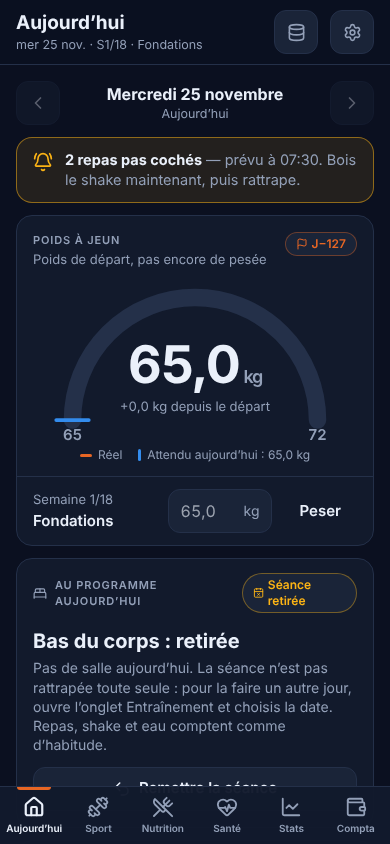
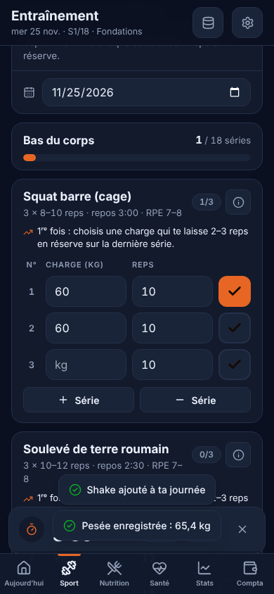
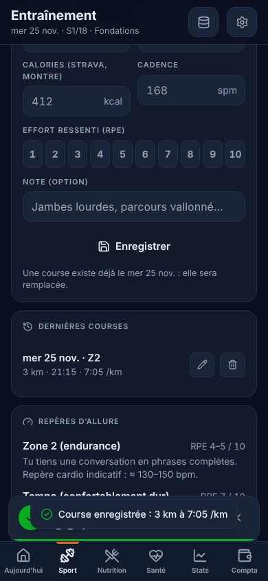
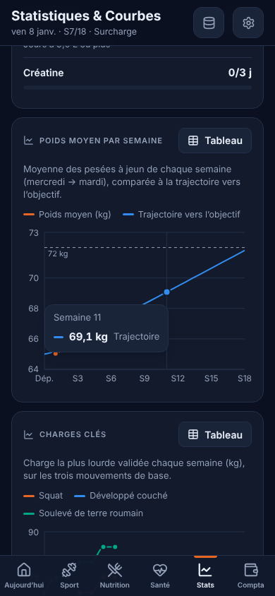

# Training App

A mobile-first web app to run an 18-week lean-bulk program (65 → 72 kg): meals and calories, strength and running logs, shopping lists, health tracking, statistics and a budget. Everything runs in the browser, in French.

**Live demo:** https://robincanovas.github.io/Training-app/ (on iPhone: Safari → Share → *Add to Home Screen*)

<p>
  
  
  
  
</p>

## Features

- **Today** – meal checklist with late-meal alerts, hydration, creatine, daily weigh-in, "how I feel" check-in, and a day navigator to fill in past days.
- **Calories** – edit the real calories of any planned meal or log a free meal (macros are estimated from the plan's split). Enter only your steps: active calories are estimated from height and weight, then calibrated on your own data, and the daily target adapts.
- **Sport** – gym log with double-progression suggestions and a rest timer, run log (pace, elevation, heart rate, calories), paste a Strava-style summary or import a CSV/JSON, and an 18-week plan.
- **Nutrition** – day types, quick recipes, a weekly shopping-list generator and meal alarms (exportable as an `.ics` calendar file).
- **Health** – equipment checklist, blood-test tracker (baseline vs week 12), body measurements every 4 weeks.
- **Stats** – weight trend against the target curve, lifts, weekly kilometres, pace per run, and a weekly review with coaching rules.
- **Budget** – prices for gear and food, expense log, monthly cap, planned vs actual spending, CSV export.

## Technical notes

- React 18 and Recharts loaded from a CDN, Tailwind CSS, bundled with esbuild into a single HTML page (`docs/index.html`).
- State lives in an external store (`useSyncExternalStore`) persisted in `localStorage`, with JSON export/import. No server, no account.
- Pure calculation modules (`src/lib`) for targets, estimates, parsing and budgeting; end-to-end tests with Playwright on 390 px and 360 px viewports (`test_app.py`).

## Run locally

```bash
npm install
npm run build        # writes dist/
```

The published page is the build output copied to `docs/index.html` (GitHub Pages: branch `main`, folder `/docs`).

## Disclaimer

This is a personal project, not medical advice. Nutrition and training figures are general guidelines.
